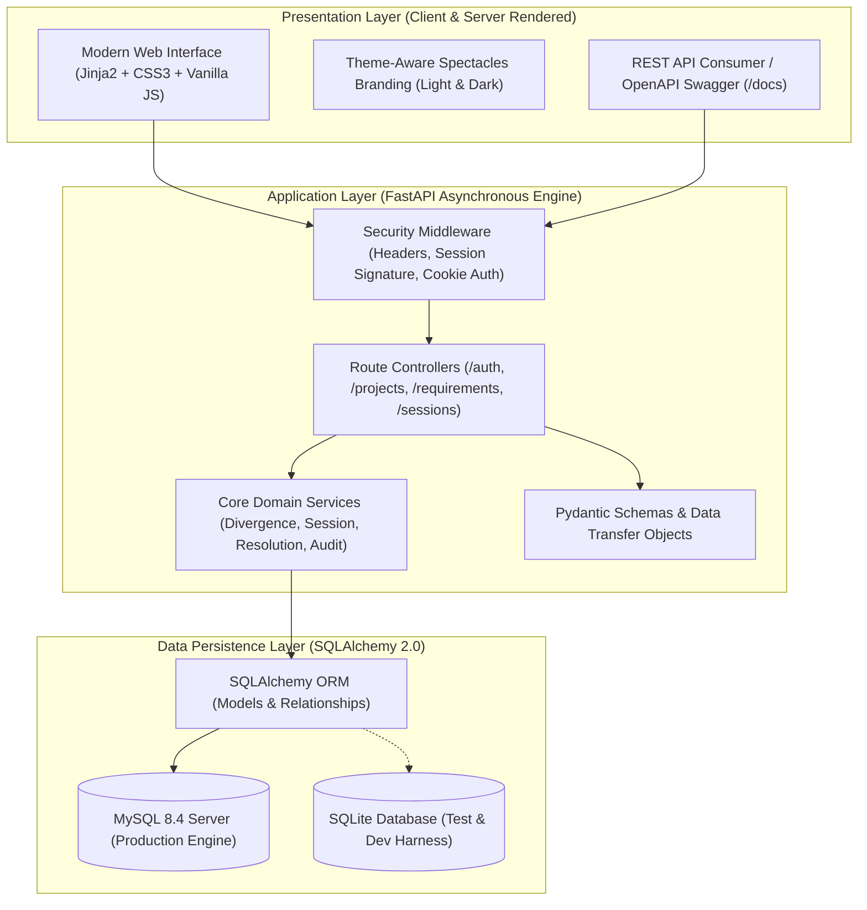
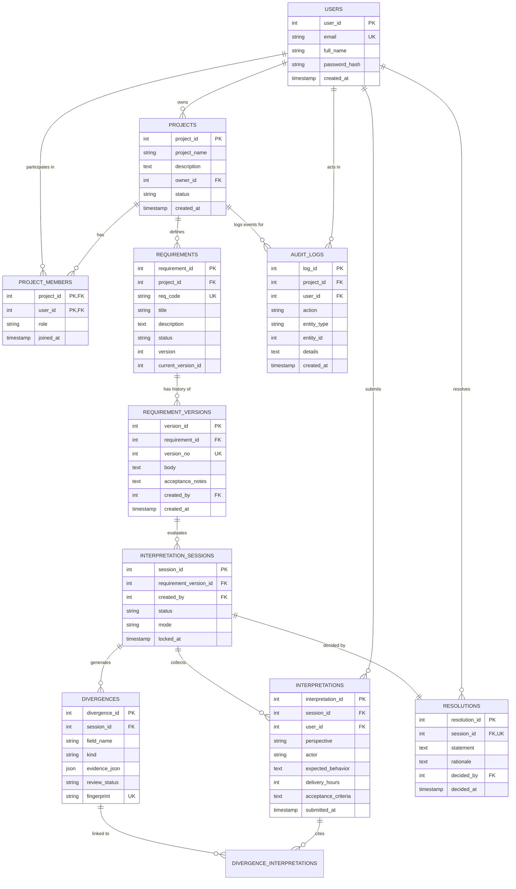

# MindTheSpec

**Requirement Interpretation & Divergence Detection Platform**  
*Academic Capstone / Semester Project | B.Tech Computer Science & Engineering (AI/ML)*  
*Platform Version:* 2.0.0 | *Status:* Production-Ready Academic Baseline

---

## 1. Project Overview & Problem Statement

In modern software engineering, one of the most frequent and costly points of failure occurs before the first line of code is written: **requirement ambiguity and divergence**. When stakeholders read high-level user stories such as *"The system must provide rapid automated payout processing"*, individual team members construct differing, unspoken mental models:
- A **backend developer** may interpret *"rapid"* as a batch job running within **24 hours**.
- A **QA engineer** may assume an end-to-end SLA of **48 hours** with manual verification checkpoints.
- A **product owner** may assume real-time instant settlement in under **10 minutes**.

Traditional requirement workflows rely on conversational reviews where vocal members dominate, leading to false consensus. Unaddressed divergence leads to costly rework, missed deadlines, and architectural drift.

**MindTheSpec** solves this problem by enforcing a **server-orchestrated blind interpretation workflow** followed by **deterministic divergence detection** and **traceable consensus resolution**. Stakeholders independently submit their interpretation of actor boundaries, delivery hours, and acceptance criteria in mutual blindness. The platform deterministically extracts conflicting parameters, flags divergences for review, and records binding consensus decisions into an immutable audit trail.

---

## 2. Project Objectives

1. **Eliminate Groupthink & Anchor Bias:** Enforce mutual blindness on the server so no participant can view peer interpretations until the project owner formally locks the session.
2. **Deterministic Divergence Detection:** Programmatically identify concrete discrepancies (e.g. numerical delivery thresholds, mismatched primary actors) without opaque heuristics or fabricated AI confidence scores.
3. **Structured Requirement Versioning:** Track evolving specifications through immutable version histories linked directly to interpretation sessions.
4. **Transparent Consensus & Auditability:** Provide project owners with decision frameworks (select submission, synthesize consensus, or reject) and record an append-only audit trail for compliance.
5. **Modern, Accessible Developer Experience:** Deliver a fast, responsive, and aesthetically pleasing interface with equal attention to Light and Dark modes (WCAG 2.2 AA compliant contrast).

---

## 3. Key Features

### 3.1 Currently Implemented Features
- **Project & Requirement Management:**
  - Full CRUD operations for multi-stakeholder software projects.
  - Requirement creation with structured acceptance criteria and code identifiers (e.g., `REQ-101`).
  - Strict immutable version control (`RequirementVersion`) preserving historical requirement baselines.
- **Mutual Blind Interpretation Engine:**
  - State machine-controlled sessions (`draft` &rarr; `collecting` &rarr; `locked` &rarr; `analyzed` &rarr; `resolved`).
  - Server-enforced blind submissions: API hides peer interpretations until atomic session lock.
  - Multi-perspective capture: primary actor, numerical delivery timeline (hours), expected behavior, and acceptance criteria.
- **Deterministic Divergence Detection:**
  - Automated analysis comparing delivery hour deltas and actor mismatches across all submissions.
  - Deterministic fingerprinting (`field_name + kind + sorted_ids`) preventing duplicate or phantom divergence records.
  - Structured evidence generation in JSON format with concrete discrepancy reporting.
- **Consensus & Resolution Workflow:**
  - Owner-guided resolution interface with full discrepancy side-by-side comparison.
  - Strategy selection: adopt specific participant submission, synthesize compromise, or reject/revise.
  - Cryptographically verifiable resolution recording linked to the active requirement baseline.
- **Security & Authorization (STRIDE Compliant):**
  - Session-based authentication using cryptographically signed HttpOnly cookies.
  - Bcrypt password hashing (`cost factor = 12`).
  - Strict Role-Based Access Control (RBAC): Owner, Analyst, Developer, Tester, Observer.
  - IDOR protection preventing cross-project data leaks.
  - Comprehensive HTTP security headers (`nosniff`, `DENY`, `strict-origin-when-cross-origin`).
- **Responsive Frontend (Sketchbook Studio Design System):**
  - Modern, playful creative-studio UI with dedicated Light (`#FDF9F7` Cream) and Dark (`#191525` Midnight Violet) modes.
  - Synchronous theme initialization eliminating flash-of-unstyled-content (FOUC).
  - SVG spectacles branding symbolizing dual perspectives and unified understanding.
  - Interactive hero workflow visualization showcasing requirement convergence.

### 3.2 Planned Future Improvements
- **AI-Assisted Semantic Similarity Analysis:** Integration of local sentence transformers / LLM embeddings to evaluate subtle semantic nuance in free-text acceptance criteria.
- **Jira & GitHub Issues Bi-directional Synchronization:** Webhook integration to import stories and post divergence resolutions directly into issue trackers.
- **Multi-Factor Authentication (MFA / TOTP):** Time-based one-time password support for enterprise compliance.
- **Real-Time WebSocket Session Synchronization:** Live attendance indicators and real-time submission count updates without manual page refreshes.

---

## 4. Technology Stack

| Layer | Technology | Version | Purpose |
|---|---|---|---|
| **Backend Framework** | Python / FastAPI | 3.11+ / 0.115+ | High-performance asynchronous REST API and route orchestration |
| **Data Validation** | Pydantic v2 | 2.9+ | Strict request/response validation and schema enforcement |
| **ORM & Database** | SQLAlchemy / PyMySQL | 2.0+ / 1.1+ | Relational data mapping, connection pooling, and transactional integrity |
| **Relational Database** | MySQL Server / SQLite | 8.4+ / 3.40+ | Production enterprise relational storage / zero-dependency test harness |
| **Template Engine** | Jinja2 | 3.1+ | Server-side HTML rendering with strict context isolation |
| **Frontend Styling** | Vanilla CSS3 / Modern Flex & Grid | Custom Tokens | Sketchbook Studio design system with semantic CSS variables |
| **Frontend Scripting** | Vanilla JavaScript (ES6+) | Native Browser | Lightweight, zero-dependency accessible DOM interactions |
| **Security & Auth** | Passlib (bcrypt) / itsdangerous | 1.7+ / 2.2+ | Strong cryptographic password hashing and signed session cookies |
| **Testing Harness** | Pytest / HTTPX TestClient | 8.3+ / 0.28+ | Automated integration, RBAC, and security regression suite |

---

## 5. System Architecture

MindTheSpec is architected as a clean, decoupled three-tier system:



### 5.1 Entity-Relationship (ER) Model



---

## 6. Installation & Setup Guide

### 6.1 Prerequisites
- **Python 3.11+** installed (`python --version`)
- **Git** installed (`git --version`)
- Optional: **MySQL Server 8.4+** (if running against full MySQL instance; otherwise SQLite works out-of-the-box for local testing)

### 6.2 Clone & Environment Setup

```bash
# 1. Clone the repository
git clone https://github.com/Aryan-07-ui/MindTheSpec.git
cd MindTheSpec

# 2. Create and activate a Python virtual environment
# On Linux / macOS:
python3 -m venv .venv
source .venv/bin/activate

# On Windows (PowerShell):
python -m venv .venv
.\.venv\Scripts\Activate.ps1

# 3. Install dependencies
pip install -r requirements.txt
```

### 6.3 Environment Variable Configuration

Copy `.env.example` to create your local `.env`:

```bash
# On Linux / macOS:
cp .env.example .env

# On Windows (PowerShell):
Copy-Item .env.example .env
```

Review and configure `.env`:

```ini
# Database Configuration
# To use SQLite for fast local development/testing:
DB_TYPE=sqlite
SQLITE_PATH=mindthespec.db

# Or configure MySQL 8.4 Server:
# DB_TYPE=mysql
# DB_HOST=localhost
# DB_PORT=3306
# DB_NAME=mind_the_spec
# DB_USER=mindthespec_app
# DB_PASSWORD=your_secure_password_here

# Application Configuration
APP_ENV=development
SECRET_KEY=change-this-to-a-secure-random-secret-key-in-production
SESSION_COOKIE_NAME=mindthespec_session
```

### 6.4 Database Initialization & Migrations

For MySQL 8.4 instances:
```bash
mysql -u root -p mind_the_spec < migrations/001_v2_schema_update.sql
```

For SQLite local environments, SQLAlchemy automatically creates all required tables on first startup.

### 6.5 Run Automated Verification Tests

Verify system integrity with Pytest:
```bash
python -m pytest -v
```

Expected output:
```text
======================= 19 passed in ~12s =======================
```

### 6.6 Seed Demonstration Data

Populate the database with a pre-configured multi-stakeholder demonstration project:
```bash
python scripts/seed_demo.py
```

### 6.7 Start the Application Server

```bash
python -m uvicorn main:app --reload --host 127.0.0.1 --port 8000
```

- Web Application: **`http://127.0.0.1:8000`**
- Interactive OpenAPI Docs: **`http://127.0.0.1:8000/docs`**
- Alternative ReDoc: **`http://127.0.0.1:8000/redoc`**

---

## 7. Demonstration Accounts

The seed script creates ready-to-test accounts representing different stakeholder perspectives:

| Role | Email Address | Password | Function in Demonstration |
|---|---|---|---|
| **Project Owner** | `owner@example.com` | `Owner123!` | Manages projects, creates requirements, initiates sessions, locks and resolves divergences. |
| **Developer** | `dev@example.com` | `Dev123!` | Submits a technical interpretation (24-hour turnaround expectation). |
| **Tester** | `test@example.com` | `Test123!` | Submits a validation interpretation (48-hour turnaround expectation). |

---

## 8. Current Development Status & Deliverables

- [x] **FR-01 to FR-17 Implemented:** Complete requirement lifecycle, blind interpretation, divergence comparison, and resolution workflow.
- [x] **SEC-01 to SEC-13 Verified:** IDOR prevention, password security, session isolation, and HTTP security headers.
- [x] **19/19 Pytest Suite Passing:** 100% automated regression test coverage.
- [x] **Sketchbook Studio Design System:** Accessible light and dark themes with zero FOUC.
- [x] **Architecture & Verification Docs:**
  - [IMPLEMENTATION_STATUS.md](IMPLEMENTATION_STATUS.md) — Detailed functional requirements verification matrix.
  - [SECURITY_CHECKLIST.md](SECURITY_CHECKLIST.md) — STRIDE threat analysis and security controls.
  - [RELEASE_CHECKLIST.md](RELEASE_CHECKLIST.md) — Production design and technical SEO checklist audit.
  - [DEMO_WALKTHROUGH.md](DEMO_WALKTHROUGH.md) — Step-by-step evaluator script.
  - [MindTheSpec_PRD_v2.md](MindTheSpec_PRD_v2.md) — Complete Product Requirements Document.

---

## 9. License & Academic Attribution

This project was developed as a solo academic computer science capstone project.  
**Author:** Aryan Kushwaha (`Aryan-07-ui`)  
**Institution:** B.Tech Computer Science & Engineering (AI/ML)  
**Academic Year:** 2026
